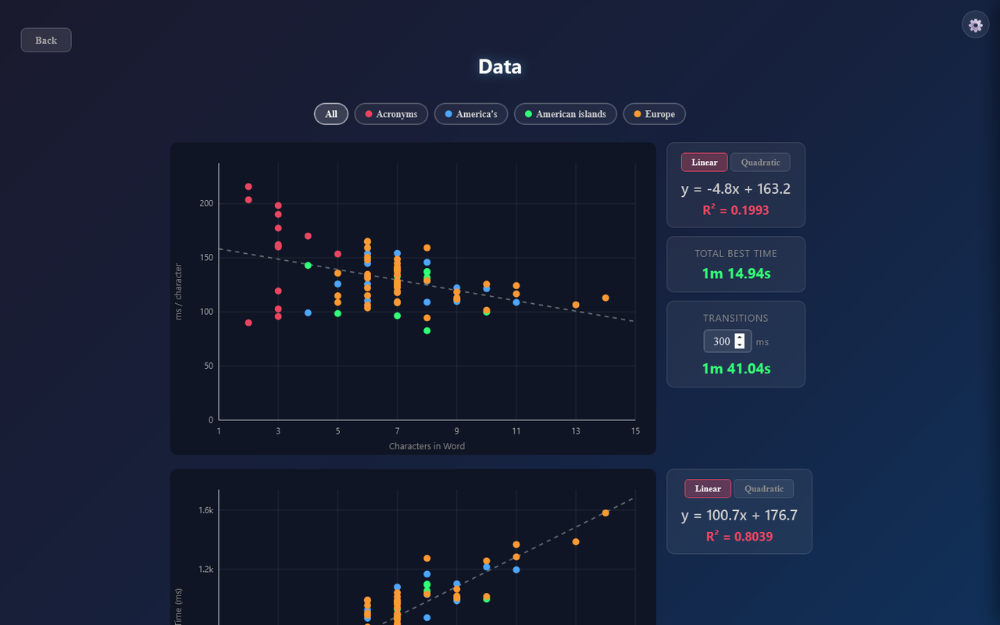
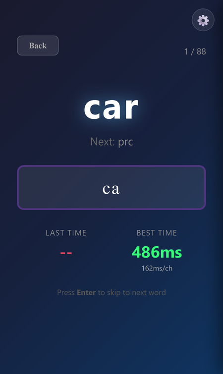

# Word Speed Trainer

A speed-typing drill for a word list, set up for country names. Type each word as fast as you can; it times every word, keeps your best, and graphs where you're slow.

**[▶ Open the live app](https://timothyhadfield.github.io/word-speed-trainer/)** · best on a laptop (it's a keyboard drill), works on phone too

  
  &nbsp;
  

## Features
- **Timed training**: one word at a time with the next one shown, timed from your first key to the last; your last and best time (and time per letter) show below.
- **Strict typing**: a wrong letter clears the word after a short pause you can set, so only clean runs count.
- **Auto Play**: drag to select a range of words (or pick a saved list like "Europe") and race through it for a total time, with a record per list.
- **Data graphs**: scatter plots of time per letter and total time against word length, with linear or quadratic fits, filters per list, and your total best time.
- **Your own words**: replace the country list with any words, one per line.
- **Several users**: each person gets their own words, best times and records; data can be downloaded as a file.

## Built with
One HTML file: plain JavaScript, canvas charts, and localStorage for saving. (`index.html` just forwards to `country_training.html`.)
